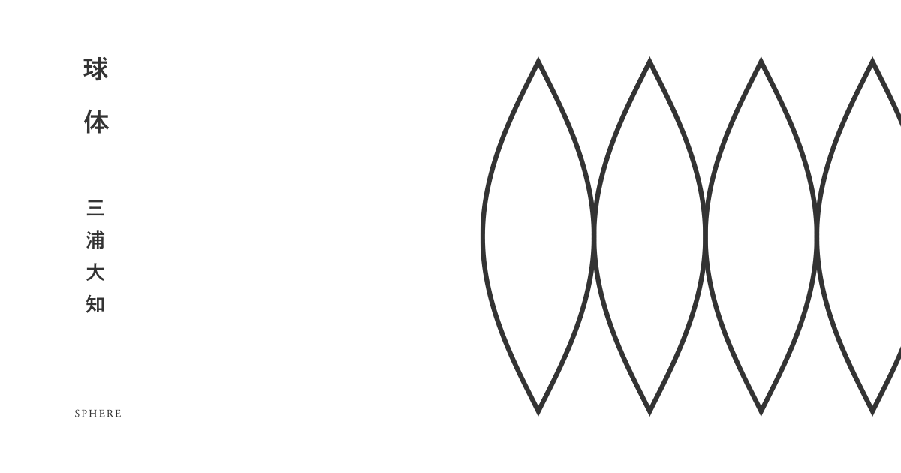

*《球体》官方视觉，© 2018 avex。图片来源：[三浦大知《球体》特设网站](https://avex.jp/daichi/sphere-special/)。*

一种可能的读法是：一个失去挚爱的人，在记忆、现实、生死与轮回之间不断寻找对方，试图重新获得两人共同存在的世界，却始终无法摆脱失去的命运。

但这张专辑真正动人的地方，不只是「一个人跨越生死寻找另一个人」，而是它所触及的更深的问题：

> 当挚爱之人曾经构成一个人理解世界的方式，失去对方以后，他又该如何继续存在于这个世界上？

整张专辑的叙事，似乎都围绕这一问题展开。

当然，《球体》并不只有一种剧情解释。[官方介绍](https://avex.jp/daichi/discography/detail.php?id=1015725)将它描述为 17 段跨越时空、相互连锁又不断重复的故事。三浦大知也在 [2018 年的 J-WAVE 访谈](https://news.j-wave.co.jp/2018/12/12143.html)中提到，两位创作者花了三年半逐首创作，最后才通过调整曲序，让各个片段构成一个整体。

因此，这 17 首歌未必适合被机械地解释为「第一天发生了什么，第二天发生了什么」。它们更像一部**以失去为起点、以寻找为过程、以轮回为结构的非线性小说**。

而这个故事的开头，很可能根本不是故事真正的开始。

## 一、故事的开端：失去之后的重逢

> **曲目 01—04**  
> 《序詞》 → 《円環》 → 《硝子壜》 → 《閾》

### 《序詞》与《円環》：为什么刚开始，就已经有人「回来」？

[《序詞》](https://utaten.com/lyric/mi18070334/)一开始，主人公就在回顾自己的人生。

他把自己想象成漂浮在海上的一艘小船。过去的生活似乎一直是在努力工作、抵抗风浪、维持生存。他追求自由，却又畏惧自由；他知道自己有想回去的地方，却不知道接下来应该去哪里。

故事最初呈现的，是一个已经失去生活方向的人。

这里有个重要的细节：他手中握着种子，相信即使在腐朽的世界里，花朵也可以绽放，可如今已经找不到播种的地方。

这颗种子可以被理解为他始终没有放弃的希望。只是他已经不知道，应该把希望寄托在哪里。

直到一个熟悉的人出现在面前。

他抬起头，看见逆着朝阳站立的「君」。随后响起一句：

> 「ただいま。」
>
> 我回来了。

这也是整张专辑第一个微妙之处：为什么故事刚刚开始，就已经有人「回来」了？

一种可能是，这根本不是第一次相遇，而是某一次循环结束之后的重新相遇。

紧接着，《円環》写到主人公走过熟悉的街道，却不断产生似曾相识的感觉：手上残留着沙子的触感、熟悉的玻璃、等待风吹起的传单，以及仿佛被封存起来的记忆。

他隐约感觉，这些东西之间存在某种联系。

由此看来，《円環》描绘的或许不是普通的散步，而是一个遗忘了过去的人，开始从周围的事物中重新认出自己的经历。

### 《硝子壜》与《閾》：一个再也无法开花的世界

《硝子壜》随后揭开了真正的问题。

原来，「君」已经不在了。

房间失去了色彩，唯独她留下的玻璃瓶还在折射光线。主人公想起她的性格：比起晴天，她更喜欢雨天；虽然装作冷淡，却很容易哭泣；比起太阳，她更喜欢月亮，因为刺眼的阳光可能使人错过真正重要的事物。

这段描写通过具体的生活习惯，让一个已经消失的人重新变得鲜活。

她曾经有自己的性格、自己的审美、自己的生活哲学。可是现在，她只剩下一只空荡荡的玻璃瓶。

玻璃瓶原本是盛放花朵的容器。如今瓶子还在，却再也没有花。

将《序詞》和《硝子壜》联系起来，便会发现一个残酷的对应：《序詞》里，主人公还相信腐朽的世界能够开花，只是不知道在哪里播种；而《硝子壜》里，他终于承认，属于他们的那朵花已经无法继续生长。

**他失去的不只是一个爱人，也失去了对未来的想象。**

在这条叙事线上，《閾》便像是一道分界线。

「閾」本身就有门槛、边界的意思。这首没有正式歌词的间奏，可以被理解为将听众从失去之后的现实，带向另一层时间与空间。

Nao'ymt 曾在 [Ableton 的访谈](https://www.ableton.com/ja/blog/naoymt/)中说明，《閾》采样了后面《クレーター》的人声。这意味着，第四首歌里已经出现了第十三首歌中的声音。

这样的音乐结构，也为非线性的时间解读提供了线索。

## 二、寻找的开始：不属于这个世界的两个人

> **曲目 05—08**  
> 《淡水魚》 → 《テレパシー》 → 《飛行船》 → 《対岸の掟》

### 《淡水魚》：他们向往的自由，可能意味着毁灭

[《淡水魚》](https://utaten.com/lyric/mi18070337/)为理解两个人的关系提供了关键线索：他们为什么如此依赖彼此？

他们就像想要前往大海的淡水鱼。

这个比喻非常残酷。大海象征广阔、自由和未知，似乎是一个值得向往的地方。然而，对于大多数淡水鱼来说，海水却是无法生存的环境。

换句话说，**他们向往的自由，可能恰恰意味着他们的毁灭。**

歌词还通过「君」的言语，透露出两人与外部世界格格不入的处境。她认为，并不是他们本身存在问题，而是他们的个性无法适应现在的环境。

这一细节，也让《序詞》中主人公的状态获得了另一层解释：他对自由的渴望、对现实的妥协，以及对腐朽世界的失望，可能一直都与两个人共同经历的生活有关。

他们不是普通地相爱，而是在一个彼此都难以适应的世界里，成为了对方仅有的理解者。

《淡水魚》还有一个令人不安的情节：主人公感觉未来将会带走「君」，于是慌忙抓住她的手。他似乎早已预感到，两个人终有一天会被迫分开。

因此，这首歌既可以读成两人过去的经历，也可以读成主人公试图改变的某一种命运。

### 《テレパシー》：那些后来才变得重要的瞬间

到了《テレパシー》，叙事变得更加明显地带有回忆色彩。

场景来到夏天的铁桥下。骤雨、绣球花、河岸、烟花。

她用手指擦去他脸上的雨水，开玩笑地告诉他不要哭。随后又鼓励他飞起来，直到能够俯视云层。

这里最动人的细节，是歌词意识到：就连这样一个微不足道的生活瞬间，有一天也会成为需要拼命回忆的东西。

这触及了失去一个人的真实体验。在失去发生之前，人往往并不知道，哪些瞬间会成为后来最重要的回忆。

而这里的「心灵感应」，并不一定意味着两个人真的拥有超自然的能力。也可能是因为主人公已经无法再与她交谈，只能不断从记忆中听见她的声音。

接下来出现了一个明确的情节连接：《テレパシー》最后，主人公发现了一张画着巨大飞行船的传单。

下一首歌就是《飛行船》。

专辑由此呈现出一种从「回忆」走向「行动」的叙事过渡。

### 《飛行船》：反抗命运，也是寻找爱人

《飛行船》中，人们排着队，依次走向一道充满光芒的门。大家相信，自己出生的意义就在那扇门后面。飞行船不断起飞，把人们带向未知的地方。

但是主人公对此产生了怀疑。

他不知道那些飞行船真正的目的地，也不愿意只是因为别人都接受某种安排，自己就跟着接受。他真正想要的，是成为自己。

这首歌可以从两个相互重叠的层面理解：

- **社会性的解释**：飞行船象征某种既定的人生道路，所有人都在被同一套规则运送到所谓正确的目的地，而主人公试图挣脱这种安排。
- **生死性的解释**：飞行船可能是穿越生与死的交通工具，主人公想要前往「君」离去后所在的世界。

这两种意义可以同时成立。因为对这个主人公来说，反抗命运和寻找爱人，本质上可能是同一件事。

### 《対岸の掟》：能够改变的，究竟是什么？

到了《対岸の掟》，他仿佛真的抵达了某个彼岸。

他在大自然中苏醒，感受到身体逐渐恢复，开始思考真正的富足是什么，以及自己究竟能够改变什么。

这里最值得注意的是，歌词表达了一个意思：过去无法改变，能够改变的只有未来。

这与「不断回到过去挽救爱人」的典型时间循环故事形成了微妙的冲突。也许主人公真正需要做的，并不是让已经发生的事情不再发生，而是改变自己面对失去的方式。

但故事还没有给出答案。

远处，一只蝴蝶正在飞翔。那是不是「君」的灵魂？主人公究竟抵达了死后的世界，还是踏入了一段新的生命？

这些问题仍然悬而未决。

唯一确定的是，他还在旅途中。

## 三、记忆与生命：破碎之后的重新生长

> **曲目 09—12**  
> 《嚢》 → 《胞子》 → 《誘蛾灯》 → 《綴化》

这一部分是整张专辑中最晦涩，也最值得反复思考的段落之一。

从《嚢》开始，作品逐渐减少了对具体人物关系的描绘，转而引入一些生物性的意象：囊、孢子、飞蛾、双螺旋、植物的异常生长。

这些意象的共同之处，在于它们都与生命如何保存、扩散、变化和延续有关。

### 《嚢》与《胞子》：记忆破碎之后，还会留下什么？

《嚢》没有正式歌词，很难仅凭曲名为它赋予明确剧情。但从它在专辑中的位置来看，它像是连接两种存在状态的容器：一个生命的结束，与另一个生命的形成之间，存在着某种封闭、孕育和等待的过程。

紧接着，[《胞子》](https://utaten.com/lyric/mi18070341/)写到主人公在浑浊的孤独之中寻找光亮。他看见破碎的玻璃，以及笼罩一切的巨大阴影。

玻璃的再次出现，自然让人联想到《硝子壜》。

之前，玻璃瓶还完整地留在房间里，保存着她曾经存在过的痕迹；现在，玻璃已经破碎。

如果说玻璃瓶象征一段完整的记忆，那么破碎的玻璃就可以象征记忆被打散、重新分布。而孢子恰恰是一种能够离开原有个体、在别处延续生命的结构。

由此可以形成一种解读：主人公正在经历某种意义上的死亡与重生，而他对「君」的记忆，并没有随着旧生命的结束而彻底消失。

### 《誘蛾灯》：真正的光明，还是危险的执念？

到了《誘蛾灯》，场景转向潮湿而不眠的城市。

空气里漂浮着孢子，街上的人戴着面具，飞蛾围绕灯光活动。歌词还出现了扭曲的记忆、过去与未来，以及双螺旋结构。

「双螺旋」很容易使人联想到 DNA。作为文学意象，它可以进一步指向生命信息的延续：一个生命即使已经结束，构成它的某些东西，仍可能以其他形式被保留下来。

与此同时，飞蛾被灯光吸引，也可以被理解成一种危险的执念。

主人公究竟是在寻找真正的光明，还是被自己无法放下的欲望反复吸引？

这首歌没有回答。

### 《綴化》：花终于再次盛开，却不再是原来的模样

随后，《綴化》把这一组意象推向了高潮。

「綴化」是一个真实存在的植物学现象，也称「带化」。植物的生长点异常地向线状扩展，可能形成带状等形态。它并不意味着植物停止生长，而是意味着植物以不同于通常状态的方式继续生长。相关解释可见[日本植物生理学会的植物问答](https://jspp.org/hiroba/q_and_a/detail.html?id=1719&key=1719&target=number)。

*带化现象的真实例子（Erigeron speciosus）。摄影：James N. Perdue（Perduejn），[Wikimedia Commons](https://commons.wikimedia.org/wiki/File:Fasciated_Showy_Daisy_July_3_2016.jpg)，[CC BY 4.0](https://creativecommons.org/licenses/by/4.0/)。网页图片已压缩。*

这个标题与歌曲中的情感变化形成了意味深长的联系。

主人公再次回忆起与「君」相处的情景。他幻想用她的头发制成画笔，画出通往天空的梯子；他记得两个人在黄昏中散步，经过废弃的水槽；他感觉只有她触碰过的地方，才能重新给失去色彩的世界带来颜色。

然后，歌词描绘了希望吸收过往的枯萎与封闭的记忆，最终使一朵巨大的花盛开。

到这里，花的意象终于形成了清晰的呼应：

- 《序詞》里，主人公拥有种子，却无处播种。
- 《硝子壜》里，主人公认为花再也不会开放。
- 《綴化》里，花终于再次盛开。

然而，这里的花不是普通生长的花。它对应着植物异常生长的「綴化」。

因此，这次盛开未必意味着简单的复原。它更像是主人公的爱、痛苦和记忆，经历了一次失控却又充满生命力的重新生长。

**那个人或许永远不会以原来的方式回来。但是，她曾经留下的东西，正在以新的形式继续存在。**

沿着这一线索，《球体》的主题也从寻找爱人，延伸到了死亡之后的生命延续。

## 四、最接近幸福的时刻：她就是整个世界

> **曲目 13—15**  
> 《クレーター》 → 《独白》 → 《世界》

### 《クレーター》：他真正寻找的，只是一个普通下午

接下来，[《クレーター》](https://utaten.com/lyric/mi18070344/)再次把故事带回了海边。

这首歌很可能包含了整张专辑最早发生的一段重要回忆。

两个人躺在海边，看着天空。蜻蜓停落在伸出的手上，远处出现飞行船。他向她保证，无论黑夜怎样降临，都能够再次找到她。

后来，她把他推向海边，两个人嬉闹，她笑着说这次算是平手。

那是一个非常普通的夏日下午。有海风，有汽笛，有沙滩，还有她的笑容。

*海边意象配图，呼应《クレーター》中那个普通的夏日下午。摄影：Dan Gold，[Wikimedia Commons](https://commons.wikimedia.org/wiki/File:Waves-crashing-on-beach_925x.jpg)，[CC0](https://creativecommons.org/publicdomain/zero/1.0/)。*

为什么要在经历了前面那么复杂的生死、记忆与生命意象之后，突然回到如此简单的日常？

这一安排，让主人公漫长旅途的目的变得清晰。

他真正寻找的，从来不是某种神秘力量，也不是永生，而是这个已经无法重现的普通下午。

他经历了漫长的旅途，试图理解世界的结构、生命的意义和轮回的规律。但最终，真正令他不愿放手的，其实只是她曾经站在身边、对他微笑的那一刻。

《クレーター》的后半部分，又直接引入了机械般的轮回，以及疲惫地寻找答案的旅人。

日常的爱情，由此与宇宙尺度的时间连接起来。人可以穿越无数时间、经历无数次生命，但他所追求的东西，也许从一开始就没有改变。

而《クレーター》这个标题，意为「陨石坑」。

它也是一个圆形的痕迹。即使造成伤痕的事物已经消失，世界也依然保留着它曾经存在过的形状。

也许「君」就是主人公世界里的那颗陨石。她已经离开，却留下了无法抹去的痕迹。

### 《独白》：没有语言的自我审视

《独白》出现在这里，像是一次向内的停顿。

它是一首没有歌词的作品。三浦大知曾在访谈中解释，创作时是先用舞蹈表达自己的构想，再由 Nao'ymt 根据舞蹈制作音乐。这个过程可见[《周刊朝日》访谈的中文译文](https://dmfansitetaiwan.blogspot.com/2018/07/201883vs.html)。

所以，这首歌的「独白」，本身就是没有语言的独白。

放进整张专辑的故事里，它可以被理解为主人公一次不需要语言的自我审视。他回想过去，回想自己失去了什么、寻找了什么。

而经历这一切之后，下一首终于是《世界》。

### 《世界》：圆满之中，已经藏着失去的可能

这是整张专辑最接近圆满的一刻。

歌词开始谈论转世。假如生命能够不断重来，那么即使经历不同的时代、不同的人生，他也相信自己始终会找到对方。

随后，主人公表达了一个强烈的情感：「君」并不是这个广阔世界中某个不起眼的存在。恰恰相反，对他而言，她本身就是整个世界。

在这条叙事线上，《世界》构成了整张专辑的情感高潮。

故事从《序詞》中主人公对世界的失望开始，到这里，他终于发现一个足以让自己重新理解世界的理由。以前的世界意味着压迫、疲惫、妥协和失去；现在，世界意味着一个具体的人。

只要她还在身边，世界就值得存在。

但也正因为如此，这一刻的幸福才格外危险。

**当一个人将爱人视为整个世界时，失去对方也就意味着整个世界的崩塌。**

而《球体》最残酷的转折，就发生在下一首歌。

## 五、故事的结局：夜晚结束，轮回重启

> **曲目 16—17**  
> 《朝が来るのではなく、夜が明けるだけ》 → 《おかえり》

### 没有新的早晨，只有夜晚的结束

如果《世界》是整张专辑的结尾，那么这会是一个关于重逢的爱情故事：两个人经历不同的生命，最后重新相遇。

但是，专辑并没有停在这里。

紧接着的《朝が来るのではなく、夜が明けるだけ》，几乎把上一首建立起来的一切瞬间摧毁。

世界再次变得空无一人。主人公独自站在黎明之前，追逐月亮，经过路灯，听见远处的电车声，回忆过去的时光。

他开始后悔自己这一生的选择，甚至想象，如果人生只是一场预演，下一次也许能够做得更好。

而理解这首歌的关键，藏在它的标题里：

> 不是早晨到来了，只不过是夜晚结束了。

这两种表达描述的可以是完全相同的自然现象，但意义完全不同。

早晨到来，通常意味着希望、开始和新生；夜晚结束，却只是一个客观的事实。世界依旧在运转，但主人公已经失去了将这种运转理解为希望的能力。

在他的感觉中，并不是自己还好好地活在世界上，而是整个世界只剩下了她的缺席。

失去一个人的悲伤，有时候并不是持续地哭泣，而是所有事情都还在正常发生。

太阳照常升起，电车照常运行，街道依旧热闹。可是对失去挚爱的人来说，一切都已经失去了原来的意义。

这里还有一个细微的呼应：在《硝子壜》里，她曾经说过，比起太阳，她更喜欢月亮；而在《朝が来るのではなく、夜が明けるだけ》里，主人公恰恰在黎明之前追逐月亮。

这一细节可以被理解为：他追逐的，其实是她看待世界的方式。

他甚至不再只是想找回她这个人，而是想找回她曾经赋予这个世界的意义。

可是太阳终究会升起。月亮终究会消失。

### 《おかえり》：结束的地方，正是开始的地方

然后就是最后一首《おかえり》。

「欢迎回来。」

这个标题留下了一个难以回答的问题：究竟是谁在欢迎谁回来？

是终于回到故乡的主人公？是终于穿越轮回、重新来到他身边的「君」？还是整个世界，正在欢迎一个新的生命诞生？

作品没有给出唯一答案。

但是，音乐提供了一个明确的结构线索：《おかえり》结尾的汽笛，与《序詞》开头的汽笛，是可以连接起来的。

Nao'ymt 在 [Ableton 的访谈](https://www.ableton.com/ja/blog/naoymt/)中解释了这个设计：汽笛声是整张作品切换时间、空间和场景的重要声音线索；《おかえり》末尾被截断的汽笛，其后续接在《序詞》中，由此形成循环。

也就是说，最后一首结束的地方，正是第一首开始的地方。

**《おかえり》的「欢迎回来」，接上《序詞》的「我回来了」。**

于是，故事重新开始。

主人公再次站在那个失去方向的世界里，再次握着那颗无处播种的种子，再次看见逆着朝阳出现的「君」。

再次走进那条似曾相识的街道，再次想起那只玻璃瓶，再次经历相遇、分离、寻找与重生。

这就是《球体》呈现出的一种形状。

## 六、比无限轮回更深的主题：如何带着失去活下去

将 17 首歌串联起来，可以得到一条跨越生死的叙事线。

但《球体》还容纳着另一种可能：它未必真的在讲一个人通过轮回不断寻找逝去的爱人，也可能是在描绘一个人如何始终无法真正走出失去。

这两个解释并不矛盾：

- **故事世界内部的解释**：两个人跨越生死，在不同的时空反复重逢，又反复分离。
- **心理层面的解释**：一个人失去了生命中最重要的人，从此困在回忆里。他不断重新经历过去，不断想象如果当初采取不同的选择，结局会不会改变。

后一种解读尤其值得展开。

整张专辑没有明确说明，「君」究竟因何离开，也没有证明主人公真的掌握了穿越时间的能力。甚至《世界》里的轮回，也是从一种假设展开的。

因此，那些轮回、飞行船、彼岸、孢子、双螺旋和植物的变异，也可能全都是主人公内心世界的具象化。

它们描述的，是一个人在失去之后，如何经历心理上的死亡、挣扎、重组和再生。

而这种重组，并不一定意味着痊愈。

这也让《綴化》这个标题获得了更深的意义。它不是普通的生长，而是异常的生长。

**一个受到伤害的生命，可能并不会恢复到最初的形状。它仍然能够活下去，但会变成另一种样子。**

同样，一个真正深爱过又失去过的人，也不可能完全回到失去之前的自己。

他会继续生活，会重新遇见别人，会重新发现世界的美。但曾经的那个人，已经永久改变了他的存在方式。

所以，《世界》中那种绝对的爱情表达，也不只有浪漫的一面。它还揭示了一种危险的依赖：当爱人成为一个人的整个世界，他所需要面对的，就不只是如何找回对方，还有如何在失去对方之后继续存在。

而在《球体》的这条叙事线中，主人公似乎始终没有完成这一步。

他每一次接近答案，都会重新回到失去。每一次以为迎来了新的早晨，最终却只是又度过了一个没有她的夜晚。

这使《球体》很难被视为一个传统意义上的幸福结局。

但它也并非完全悲观。因为专辑中始终有另一条与失去并行的线索，那就是生命的延续：

**种子 → 空瓶中无法开放的花 → 孢子的传播 → 异常却旺盛的生长。**

「君」虽然不在了，但是她曾经创造的爱、记忆和影响，并没有彻底消失。它们改变了主人公，也不断在新的生命里呈现出不同的形状。

从这个角度来说，《球体》中的轮回并不一定是一种惩罚。

它也可以是一种延续。

## 七、为什么是《球体》，而不是《円環》？

专辑第二首就叫《円環》，意味着循环、圆环。如果作品只是讲无限重复的时间，那么「圆环」似乎已经足够了。但专辑最终的名字是《球体》。

从意象层面来看，这两者之间存在一个值得思考的区别。

圆环可以被视为一条封闭的路径。沿着这条路径前进，最终会回到原点。

而球体的表面容纳着无数条不同的路径。从任何方向出发，都可以经过不同的地方，却始终没有真正离开这个整体。

这一差别，与专辑的叙事方式形成了呼应。

主人公可能经历不同的人生、不同的选择、不同的记忆，甚至不同的生死状态。这些经历并不完全相同，所以整张专辑不一定是在讲一个人机械地重复同一天。

它更像是在讲：

> 无论生命怎样变化，无论时间怎样流动，他始终无法脱离那个由「君」构成的世界。

这也让《世界》成为整张专辑非常特殊的一首歌。《世界》既是人物生活的现实，也是主人公心中的那个人。

与此同时，地球本身就是一个球体。人生活在世界之中，也很难完全脱离自身的经验，站到所处的世界之外去理解它。

就像主人公始终生活在自己对「君」的记忆里，无论他怎样寻找，都无法真正站到这段关系之外。

不过，球体还有另外一种含义：它没有绝对的起点与终点。因此，站在不同的位置上，看到的故事也会不同。

《球体》可以被读成一个人不断失去爱人的悲剧，也可以被读成两个灵魂无论经历多少次生命都一定能够重逢的爱情故事，还可以被读成一个人不断经历自我死亡与重生的成长故事。

这些解释不一定需要互相排斥。

它们就像从不同方向观察同一个球体。

## 尾声：一个关于失去与重逢的故事

沿着这条叙事线，《球体》可以被重新讲述为这样一个故事。

有一个男人，曾经与一个女孩相爱。

他们都不太适应这个世界。这个世界要求他们遵循规则、接受现实、过上所谓正确的生活。但是，他们在彼此身上找到了自由。

他们一起看过夏天的烟花，在雨中的铁桥下躲雨，在海边嬉闹，曾经认真地相信，只要两个人在一起，就可以去任何地方。

后来，女孩消失了。

男人独自留在原来的世界里。所有东西都还在，只有她不在了。

他开始寻找她。他走过熟悉的街道，追逐回忆中的声音，登上通往未知世界的飞行船，来到生与死的边界。

他经历漫长的黑夜，看见记忆破碎，又看见新的生命从碎片中生长。他一次次改变自己，一次次试图找到不同的未来。

终于，在某一个世界、某一段人生里，他再次遇见了她。

他明白，自己一直寻找的其实不是某个特别的地方。他想回去的地方，就是她在的地方。

但是幸福并没有永久停留。

世界再次失去她。男人重新陷入漫长的夜晚。

他开始想，如果人生能够重新来过，自己一定会做得更好。于是，当又一声汽笛响起，他再次踏上旅途。

他不知道这是不是自己第一次经历这样的故事，也不知道未来还要经历多少次。

他只知道，当那个熟悉的身影再次出现在晨光里时，他仍然会向她伸出手。

然后，他会听见那句：

「我回来了。」

而世界又一次开始运转。

---

在这样的解读中，《球体》讲述的是一个人不断失去自己的整个世界，却又因为无法停止爱那个人，而让世界一次次重新诞生的故事。

它最悲伤、也最美丽的地方在于：

**一个真正爱过又失去过的人，再也无法回到从未遇见过对方的生命。**

他会带着她留下的痕迹继续活下去。无论经历多少次变化，那些痕迹都仍然是他的一部分。

所以，这张专辑的主题或许最终从「如何再次找到爱人」，转向了另一种更深的理解：

> 即使再也找不到她，他所存在的每一个世界，仍然有她的身影。

在这条解读路径中，《世界》也因此成为整张专辑最重要的情感支点。

因为《球体》最终追问的，不仅是人为什么会相遇、为什么会失去、为什么会轮回。

而是：**究竟是什么，让一个人的存在有了世界的意义。**
